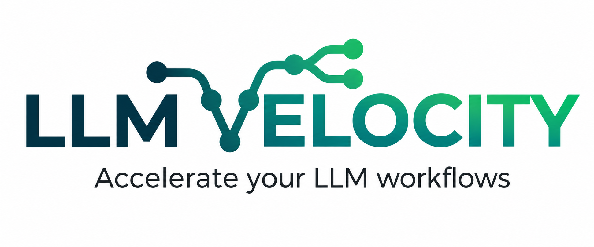

<div align="center">



#  LLM Velocity

### Lightweight Framework for Building High-Performance, Cost-Effective AI Agents

<br/>

[](https://pypi.org/project/llm-velocity/)
[](https://www.python.org/)
[](LICENSE)

</div>

<br/>

---

# ⚡ Introduction

`llm_velocity` is a lightweight framework designed to build high-performance, cost-effective AI agents. It drastically reduces LLM call expenses and accelerates response times by intelligently optimizing how the language model is utilized.

<br/>

---

# ✨ Features


### 🛠️ Native Tool Calling

> **Reduce LLM token consumption by up to 70% in tool-calling workflows.**

The framework automatically handles multi-turn conversations and tool invocation, minimizing LLM calls and unnecessary token consumption while enabling faster, more efficient, and deterministic agent execution.

### 🚀 Smart Response Recall

> **Never compute the same informational or knowledge-seeking prompts twice.**

`llm_velocity` intelligently memorizes your previous requests, returning instant responses instead of making redundant llm calls.

<br/>

---

# 🤔 Why Use LLM Velocity?
- **LLM-Free Intent Detection** — Identify the appropriate tool without requiring an LLM call for every request.
- **Lower Token Consumption** — Reduce unnecessary LLM usage and overall token consumption.
- **Customizable Error Messages** — Let developers define their own user-friendly error messages for validation and tool-related errors.
- **Avoid Repeated LLM Calls** — Reuse results for repeated informational and knowledge-seeking prompts.
- **Easy to Learn** — A simple API that can be understood within **10–20 minutes**.
- **Quick and Easy Setup** — Minimal configuration required to get started.

<br/>

---


# ⏱️ Token Usage Benchmark

A simple flight-booking Prompt-based agent benchmark shows how `llm_velocity` can significantly reduce token usage in tool-calling workflows.

| Agent                         | Approx. Token Usage |
| ----------------------------- | ------------------: |
| Standard Flight Booking Prompt-based Agent |       ~1,500 tokens |
| With `llm_velocity`           |         ~450 tokens |
| **Reduction**                 |            **~70%** |

In this benchmark, the same flight-booking workflow used approximately **1,500 tokens** with a conventional agent approach, while the `llm_velocity` implementation used approximately **450 tokens**.

<br/>

---

# 📦 Installation

Install `llm_velocity` directly from PyPI:

```bash
pip install llm_velocity
```

---

# 🚀 Quickstart

The following example demonstrates a complete tool-calling workflow using LLM Velocity.

### Workflow

| Step  | Description                                         |
| ----- | --------------------------------------------------- |
| **1** | Define validation callbacks.                        |
| **2** | Define the available tools and their parameters.    |
| **3** | Initialize `VelocityEngine`.                        |
| **4** | Initialize the internal setup.                      |
| **5** | Provide the previous conversation turns.            |
| **6** | Execute the conversation with tool calling enabled. |
| **7** | Receive the resolved tool parameters.               |

### Complete Example

```python
from llm_velocity import VelocityEngine
from llm_velocity.models import models
from typing import Any

# 1. Define Local Validation Callbacks

def validate_from_location(value: Any) -> str | None:
    if not value or not str(value).strip():
        return "Please provide where you are flying from."

    available_locations = ["USA", "India", "Japan"]

    if value not in available_locations:
        return f"Please provide a valid departure location. We only provide flights from: {', '.join(available_locations)}."

    return None


def validate_date(value: Any) -> str | None:
    if not value or not str(value).strip():
        return "Please provide a booking date."

    return None


# 2. Define Tools with Validation

tools_definition: dict[str, models.ToolInfo] = {
    "search_flights": models.ToolInfo(
        name="search_flights",
        description="Search for available flights.",
        parameters=[
            models.ToolParameters(
                name="from_location",
                description="The departure city or airport.",
                validationCallback=validate_from_location,
            ),
            models.ToolParameters(
                name="date",
                description="The date of travel.",
                validationCallback=validate_date,
            ),
        ],
    ),
}


# 3. Initialize the LookUp Store

velocity_engine = VelocityEngine(
    llm_provider=models.LLMProvider.GEMINI.value,
    llm_model="gemini-1.5-flash",
    tools_definition=tools_definition,
    api_key="YOUR_API_KEY"
)


try:
    velocity_engine.init_setup()
except Exception as e:
    import logging
    logging.error(f"Failed to initialize: {e}")


# 4. Execute Multi-Turn Conversation

user_context = [
    models.UserChatReq(
        user_message="Find flights from the UK",
        llm_response="Please provide a valid departure location. We only provide flights from: USA, India, Japan.\nPlease provide a booking date."
    ),
    models.UserChatReq(
        user_message="I am flying from Japan",
        llm_response="Please provide a booking date."
    ),
    models.UserChatReq(
        user_message="December 2nd 2026",
        llm_response="{'from_location': 'Japan', 'date': '2026-12-02'}"
    ),
]


try:
    res = velocity_engine.call(user_context, True)
    print(f"Response: {res}")
except Exception as e:
    print(f"Execution Error: {e}")
```

---

# 🎓 Detailed Usage Guide

> Follow the steps below to configure `llm_velocity` for your own agent workflow.

---

# 🧩 Step 1: Define Validation Callbacks

Validation callbacks allow you to validate tool parameters locally before the tool is executed.

A validation callback must follow this structure:

```python
def callback_name(value: Any) -> str | None:
    if VALIDATION_CONDITION:
        return "MESSAGE_TO_SEND_TO_USER"

    return None
```

### 💡 Example

```python
from typing import Any


def validate_from_location(value: Any) -> str | None:
    if not value or not str(value).strip():
        return "Please provide your departure location."

    available_locations = ["USA", "India", "Japan"]

    if value not in available_locations:
        return (
            "Please provide a valid departure location. "
            f"Available locations: {', '.join(available_locations)}."
        )

    return None
```

### 🔍 Validation behavior

A validation callback should:

* ✅ Return `None` when the value is valid.
* ❌ Return a `str` containing the user-facing validation message when the value is invalid.
* 🧩 Handle missing values when the parameter is required.
* ⚙️ Perform application-specific validation locally.

For example:

```python
def validate_amount(value: Any) -> str | None:
    if value is None:
        return "Please provide an amount."

    if value <= 0:
        return "Amount must be greater than 0."

    if value > 20000:
        return "Amount cannot exceed 20,000."

    return None
```

---

# 🛠️ Step 2: Define Your Tools

Tools are defined using `models.ToolInfo`.

Each tool contains:

* 🔹 A tool name
* 🔹 A tool description
* 🔹 A list of parameters
* 🔹 A validation callback for each parameter

### 📐 Basic Structure

```python
from llm_velocity.models import models

tools_definition: dict[str, models.ToolInfo] = {
    "TOOL_NAME": models.ToolInfo(
        name="TOOL_NAME",
        description="DESCRIPTION_OF_THE_TOOL",
        parameters=[
            models.ToolParameters(
                name="PARAMETER_NAME_1",
                description="DESCRIPTION_OF_PARAMETER",
                validationCallback=VALIDATION_CALLBACK,
            ),
            models.ToolParameters(
                name="PARAMETER_NAME_2",
                description="DESCRIPTION_OF_PARAMETER",
                validationCallback=VALIDATION_CALLBACK,
            ),
        ],
    ),
}
```

### 💡 Example

```python
tools_definition: dict[str, models.ToolInfo] = {
    "search_flights": models.ToolInfo(
        name="search_flights",
        description="Search for available flights.",
        parameters=[
            models.ToolParameters(
                name="from_location",
                description="The departure city or airport.",
                validationCallback=validate_from_location,
            ),
            models.ToolParameters(
                name="date",
                description="The date of travel.",
                validationCallback=validate_date,
            ),
        ],
    ),
}
```

> 💡 The tool definition tells LLM Velocity what information is required before a tool can be executed.

---

# ⚙️ Step 3: Initialize `VelocityEngine`

Import and initialize `VelocityEngine`:

```python
from llm_velocity import VelocityEngine

velocity_engine = VelocityEngine(
    llm_provider="YOUR_LLM_PROVIDER",
    llm_model="YOUR_LLM_MODEL",
    endpoint_url="OLLAMA_LLM_URL",
    tools_definition=tools_definition,
    api_key="YOUR_API_KEY",
    llm_temperature=0.7,
)
```

## 🔧 Configuration Parameters

### `llm_provider`

Specifies which LLM provider should be used.

Currently supported providers:

```text
openai
gemini
anthropic
ollama
```

Example:

```python
llm_provider="gemini"
```

---

### `llm_model`

Specifies the model that should process the requests.

Example:

```python
llm_model="gemini-1.5-flash"
```

The model name must be supported by the selected provider.

---

### `endpoint_url`

Specifies the LLM endpoint URL.

This is primarily required when using Ollama.

Example:

```python
endpoint_url="http://localhost:11434"
```

For other providers, this parameter can generally be omitted unless a custom endpoint is supported.

---

### `tools_definition`

The tool definitions used by the engine.

Example:

```python
tools_definition=tools_definition
```

This tells LLM Velocity which tools are available and which parameters are required.

---

### `api_key`

API key used to authenticate with the selected LLM provider.

Example:

```python
api_key="YOUR_API_KEY"
```

For Ollama, an API key is generally not required.

---

### `llm_temperature`

Controls the LLM's response temperature.

Example:

```python
llm_temperature=0.5
```

The default value is:

```text
0.7
```

For more deterministic tool-parameter extraction, a lower temperature can be useful.

---

# 🔌 Step 4: Initialize the Engine

After creating the `VelocityEngine`, initialize its setup:

```python
try:
    velocity_engine.init_setup()
except Exception as e:
    import logging
    logging.error(f"Failed to initialize: {e}")
```

`init_setup()` prepares the engine before processing conversations.

It should be called before using:

```python
velocity_engine.call(...)
```

---

# 💬 Step 5: Build the Conversation Context

LLM Velocity supports multi-turn conversations.

Conversation turns are represented using `models.UserChatReq`.

```python
user_context = [
    models.UserChatReq(
        user_message="Find flights from Japan",
        llm_response="Please provide a booking date.",
    ),
    models.UserChatReq(
        user_message="December 2nd 2026",
        llm_response="{'from_location': 'Japan', 'date': '2026-12-02'}",
    ),
]
```

Each conversation entry contains:

### `user_message`

The message sent by the user.

```python
user_message="Find flights from Japan"
```

### `llm_response`

The response generated for that user turn.

```python
llm_response="Please provide a booking date."
```

> 💡 The conversation context allows LLM Velocity to use information provided across multiple turns when resolving tool parameters.

---

# ▶️ Step 6: Execute the Conversation

Call the engine using:

```python
response = velocity_engine.call(
    user_context,
    True,
)
```

The second argument determines whether the request should be processed as a tool-calling workflow.

```python
velocity_engine.call(user_context, tool_calling)
```

### 🟢 Tool calling enabled

```python
velocity_engine.call(
    user_context,
    True,
)
```

When `True`, LLM Velocity processes the conversation for tool parameter resolution and tool calling.

### ⚪ Tool calling disabled

```python
velocity_engine.call(
    user_context,
    False,
)
```

When `False`, the request is processed without tool-calling behavior.

The default value is:

```python
False
```

---

# 📄 License

This project is licensed under the [MIT License](LICENSE) - see the LICENSE file for details.

Copyright (c) 2026 [Aditya Raj Singh Chouhan]

<br/>

<div align="center">

**⚡ LLM Velocity — Faster, Efficient & Deterministic LLM Workflows**

</div>
